# Corner-ray perimeter

`convexdecomp.corner_perimeter` splits a building footprint into perimeter zones along the facades and one or more
core parts, before a convex decomposition cuts what is still not convex. A band 4.5 m deep runs along every facade,
and the corners of the footprint cast rays into the building along their bisectors. The rays and the band's inner
line cut the footprint into zones, and ten rules and a tidy step clean up what they leave. No step moves a point of
the footprint's outline, so the zones always tile the footprint exactly. Zones that are not convex are left for the
convex decomposition.

The package needs only numpy, shapely and `convexdecomp.core.scores`; it does not draw.

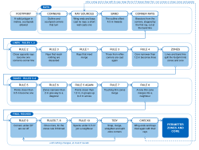

*The steps in the order they run. The rule numbers are those of the settings and the figures; rule 2 runs before
rule 1, because it is decided on the rays as cast, and rule 3 runs in two parts around rule 1. The final rounds
repeat until the zones no longer change; the checks then run the whole procedure again for a wing end or bay with
its rays.*

## Use

```python
from shapely.geometry import box
from convexdecomp.corner_perimeter import CornerRayConfig, corner_ray_perimeter

result = corner_ray_perimeter(box(0, 0, 20, 12))                 # the default settings
result = corner_ray_perimeter(poly, CornerRayConfig(band_m=4.0))  # other settings
result = corner_ray_perimeter(poly, upto="narrow_core")           # the state after rule 4
result = corner_ray_perimeter(poly, skip=("diagonals",))          # without rule 6

for zone, kind in result.zones:      # kind: zone, thin (narrower than min_zone_width_m) or core
    ...
result.counts()                      # zones, core parts, thin, not convex, sharp, specks, and per step
```

The footprint is a valid shapely polygon in metres (courtyards allowed), for example a building in its own local
frame. From the command line:

```bash
python -m convexdecomp.corner_perimeter settings                     # the settings table as JSON
python -m convexdecomp.corner_perimeter zones "POLYGON ((...))" band_m=4
```

## Where the code is

| Module | What it holds |
| --- | --- |
| `procedure.py` | `corner_ray_perimeter`, `PerimeterResult`, `STEPS` and `STAGES`; `_perimeter` calls the steps in the order they run, `_final_rounds` repeats rules 9, 7, 8, 10 and the tidy step, `_check_ray_sources` runs the wing-end and bay checks |
| `sources.py` | which corners cast rays: wing ends, bays and short walls |
| `rays.py` | the corners, the band, and the rays cast, cut at the band line and stopped where they reach another ray |
| `lines.py` | rules 1 to 3, on the lines |
| `core.py` | rule 4, narrow core becomes lines |
| `zones.py` | the zones, and rules 5 to 10 on them |
| `tidy.py` | the tidy step |
| `geometry.py` | the small geometric helpers the steps share, and `Line` |
| `settings.py` | `CornerRayConfig`: every threshold and switch, with what a settings page needs to show it |
| `preview.py` | the layers and numbers of one building for a settings page |

Each rule is one function, named for what it does; the table below names them. `_perimeter` switches a step off
for `upto` and `skip` through its `on()` check, passed to the step as its `active` argument (`discard` for rule 3)
or wrapped around the call. `STEPS` holds the stages as data: stage, rule number, title and functions.

| Runs | Step | Function | Stage (`upto`, `skip`) | Settings |
| --- | --- | --- | --- | --- |
| 1 | Which corners cast rays | `rays.corners`, `sources.ray_sources` (`wing_end_pairs`, `bay_runs`, `short_wall_plan`), `sources.casting_corners` | `rays` | Wing ends, Short walls, Bays |
| 2 | Band | `rays.offset_band` (bays cut off by `sources.bay_caps`) | `band` | Band and rays |
| 3 | Corner rays | `rays.cast`, `rays.to_band` | `rays` | Band and rays |
| 4 | Rule 2: close opposite rays become one line | `lines.join_opposite_rays` (pairs from `lines.opposite_pairs`) | `opposite` | `opposite_gap_m`, `opposite_angle_deg` |
| 5 | Rule 3: rays that reach nothing are discarded | `lines.stop_rays` (rays stop on the first ray: `rays.trim`) | `discard` | |
| 6 | Rule 1: rays that meet merge | `lines.merge_meeting_rays` | `merge_rays` | |
| 7 | Rule 3: reflex corners' rays are cast again | `lines.cast_reflex_rays_again` | `discard` | `keep_reflex_rays`, `recast_discarded` |
| 8 | Rule 4: narrow core becomes lines | `core.narrow_core_to_lines` (`align_legs`, `fill_notches`, `narrow_tips`, `refit`, `run_on_spines`) | `narrow_core` | Narrow core |
| 9 | Zones | `zones.form_zones` (`node_lines`, `zones_from`) | | |
| 10 | Rule 5: close points become one | `zones.merge_close_points` | `close_points` | Close points and narrow zones |
| 11 | Rule 6: narrow zones give way to a diagonal | `zones.narrow_zones_to_diagonals` | `diagonals` | Close points and narrow zones |
| 12 | Rule 5 again: close points, longer reach | `zones.merge_close_points` | `corner_groups` | Close points and narrow zones |
| 13 | Rule 7: touching thin zones merge | `zones.merge_touching_thin_zones` | `thin_touching` | Thin zones, sharp corners and specks |
| 14 | Rule 8: lone thin zones merge | `zones.merge_lone_thin_zones` | `thin_lone` | Thin zones, sharp corners and specks |
| 15 | Rule 9: sharp corners are cut off | `zones.cut_sharp_corners` (the taker: `zones.taker_across`) | `sharp` | Thin zones, sharp corners and specks |
| 16 | Rules 7 and 8 once more | as 13 and 14 | `sharp` | `repeat_thin_after_sharp` |
| 17 | Rule 10: specks join a neighbour | `zones.join_specks` | `specks` | Thin zones, sharp corners and specks |
| 18 | Tidy zone corners | `tidy.tidy_corners` (`snap_to_outline`, `merge_close_again`, `straighten_corners`, `drop_collinear`, each move through `try_move`) | `tidy` | Tidy zone corners |
| 15-18 | Repeat until nothing changes | `procedure._final_rounds` | | `repeat_until_stable` |
| 19 | Wing-end and bay checks | `procedure._check_ray_sources` | | `wing_end_check`, `bay_check` |

`upto` counts in the order of the rule numbers (the order of `STAGES`), not in the order the steps run: `upto="merge_rays"`
is the state after rule 1 without rules 2 and 3, as rule 1's figure shows it.

## The steps, in the order they run

The figures show examples from ConvexDecomp's 990-footprint BEM4AI sample, before and after a step (letters run
left to right, top to bottom). The figures of the wing ends and rules 1 to 10 are drawn with the short walls, bays
and tidy step switched off, so that each shows its own step; `tools/corner_perimeter/note_figures.py` draws them.

### Which corners cast rays

Every corner of the outline and the courtyards (a vertex where the outline turns by at least `min_turn_deg`) casts a
ray, except:

- **Wing ends.** The two convex corners of an end wall shorter than `wing_end_max_m` whose side walls are parallel
  within `wing_end_parallel_deg` cast no ray: the wing's zones reach from side to side instead of being split into
  strips along its axis.
- **Bays.** With `bays`, a bay casts rays only from its two base corners, so the bay and the triangle behind its
  opening become one zone instead of a fan of thin zones. A bay is a run of at least `bay_min_corners` convex corners
  (a wiggle reflex by less than `bay_wiggle_deg` counts as convex) between two reflex base corners, whose opening
  (base corner to base corner) lies inside the footprint and is at most `bay_width_band` band depths long, whose
  corners all lie outside the opening and at most `bay_depth_band` band depths from it, and where the walls before
  and after it each run within `bay_edge_deg` of the opening's line. A bay whose two corners are a wing end stays a
  wing end; a wing end inside a longer bay is the bay's.
- **Short walls.** With `short_wall_one_ray`, a wall shorter than `short_wall_m` between two corners that both cast
  rays casts one ray, since the two would bound a needle or a speck: a step (one convex, one reflex corner) only the
  reflex corner's ray, a chamfer (two convex corners between walls at least `short_wall_m` long, with
  `short_wall_chamfers`) one ray from its middle (`short_wall_midpoint`). With `short_wall_to_band` the ray runs to
  the band line's corner that the dropped ray, or the chamfer's merged ray, would have reached; with
  `short_wall_tooth` the second reflex corner of a tooth (a convex corner between two short steps) continues the
  tooth's wall. Wing ends, bays and walls between two reflex corners keep their rays.

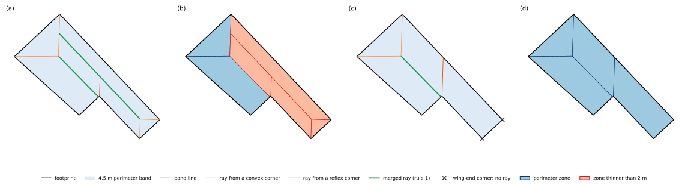

*osm_0351's leg, 2.8 m wide: (a, b) rays and zones with rays from the two corners of its end wall, (c, d)
without them.*

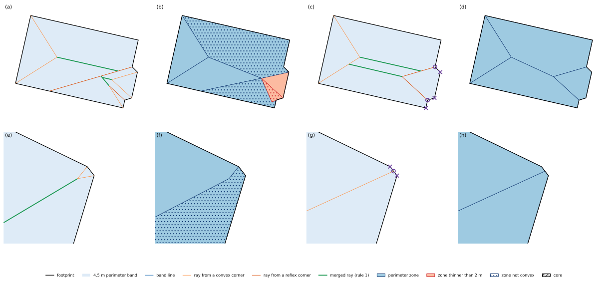

*Short steps (osm_0379, top) and a chamfer (osm_0423, bottom): rays and zones with two rays per short
wall (a, b, e, f) and with one (c, d, g, h). Crosses mark the corners without a ray of their own, circles where the
one ray starts.*

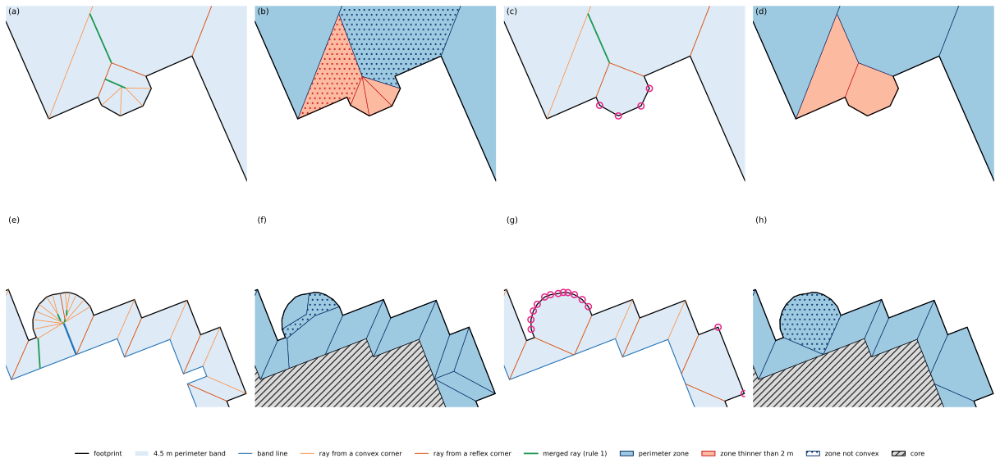

*osm_0900's polygonal bay (top) and osm_0377's round bay (bottom): rays and zones without the bay rule
(a, b, e, f) and with it (c, d, g, h). Circles mark the bay corners without rays.*

**Code:** `rays.corners`; `sources.ray_sources` (`wing_end_pairs`, `bay_runs`, `short_wall_plan`) decides,
`sources.casting_corners` gives the corners that cast, with the short walls' rays in their place. Stage `rays`.
Settings: Wing ends, Short walls, Bays.

### Band and corner rays

The footprint is offset inwards by `band_m` with mitred corners; its inner boundary is the band line, what lies
inside it the core (with `bays_in_band`, the offset starts from the footprint with its bays cut off at their
openings). Every casting corner casts a ray along its bisector. A ray is cut off at the band line and stops on the
first ray it reaches: all rays grow at the same speed, and two arriving within `tie_m` both stop.

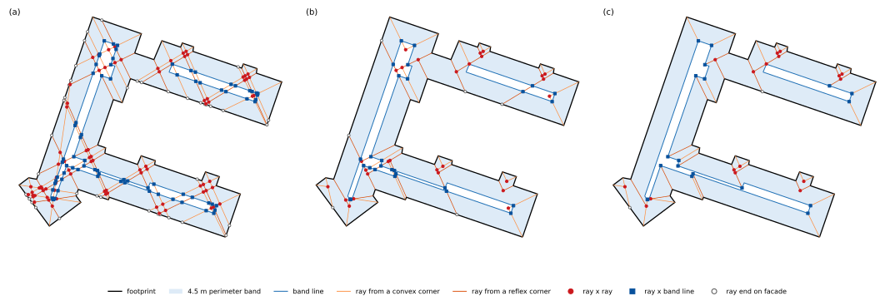

*osm_0699: (a) every ray to the facade, (b) rays stopped by the first ray, (c) rays cut at the band line.*

**Code:** `rays.offset_band` (with `sources.bay_caps`), `rays.cast`, `rays.to_band`; the stopping is `rays.trim`,
called by rule 3. Stages `band` and `rays`. Settings: Band and rays.

### Rule 2: close opposite rays become one line

Two rays running in opposite directions (within `opposite_angle_deg`) that each pass within `opposite_gap_m` of the
other's corner become one line from corner to corner. Decided on the rays as cast, before they stop on each other.

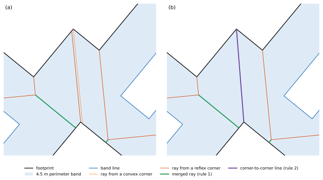

*osm_0499's connector, (a) before and (b) after.*

**Code:** `lines.join_opposite_rays`, with the pairs from `lines.opposite_pairs`. Stage `opposite`. Settings:
`opposite_gap_m`, `opposite_angle_deg`.

### Rule 3: rays that reach nothing are discarded

The rays stop on the first ray they reach, on the band line or on a corner-to-corner line. A ray that reaches the far
facade without meeting anything is discarded, and the others are stopped again without it, until none reaches the
facade. A ray that the ray of a neighbouring corner ends on is kept, as the two close a triangle for rule 1.

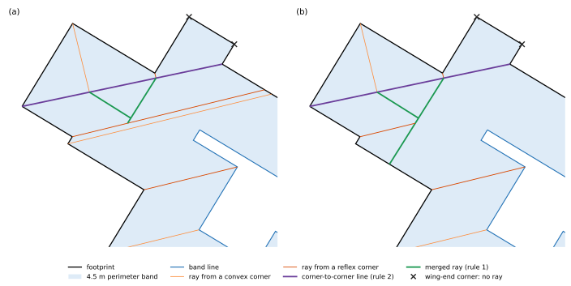

*osm_0353's left end, (a) before and (b) after.*

**Code:** `lines.stop_rays`. Stage `discard`. No settings of its own; the second part below decides which rays
come back.

### Rule 1: rays that meet merge

Where two rays meet, the ray that is hit is cut there, and one ray goes on from the meeting point between the two
directions to the first line it meets.

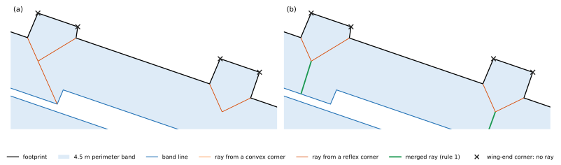

*osm_0699's lower wing with two bays, (a) before and (b) after.*

**Code:** `lines.merge_meeting_rays`. Stage `merge_rays`. No settings.

### Rule 3, second part: reflex corners' rays are cast again

With `keep_reflex_rays`, a discarded ray from a reflex corner is cast again, now that the merged rays are there, and
stops on the first line it meets: a zone can only be convex if a line leaves every reflex corner. With
`recast_discarded`, every discarded ray is cast again.

**Code:** `lines.cast_reflex_rays_again`. Stage `discard`. Settings: `keep_reflex_rays`, `recast_discarded`.

### Rule 4: narrow core becomes lines

Legs of the core narrower than `leg_width_m` (out along one side, across a short tip, back along a side parallel
within `leg_angle_deg`), notches leaving the core thinner than `notch_passage_m` (`fill_notches`), and parts, tips
and passages thinner than `narrow_core_m` (whole parts with `collapse_narrow_parts`) become lines of the band. The
shorter side moves onto the longer one, or both half way when their lengths are within `similar_sides_ratio`. The
lines that ended on a moved core corner follow it, and the line of a narrow part runs on to the next line. Core
never vanishes: it becomes a line.

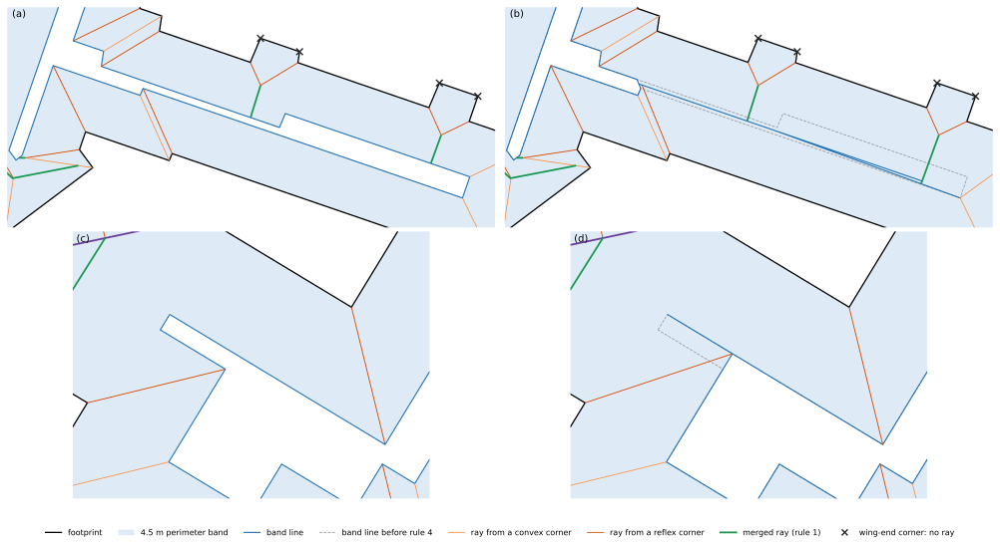

*Legs: osm_0699's lower wing (a, b) and osm_0353's left core arm (c, d), before and after; the dashed
line is the band line as offset.*

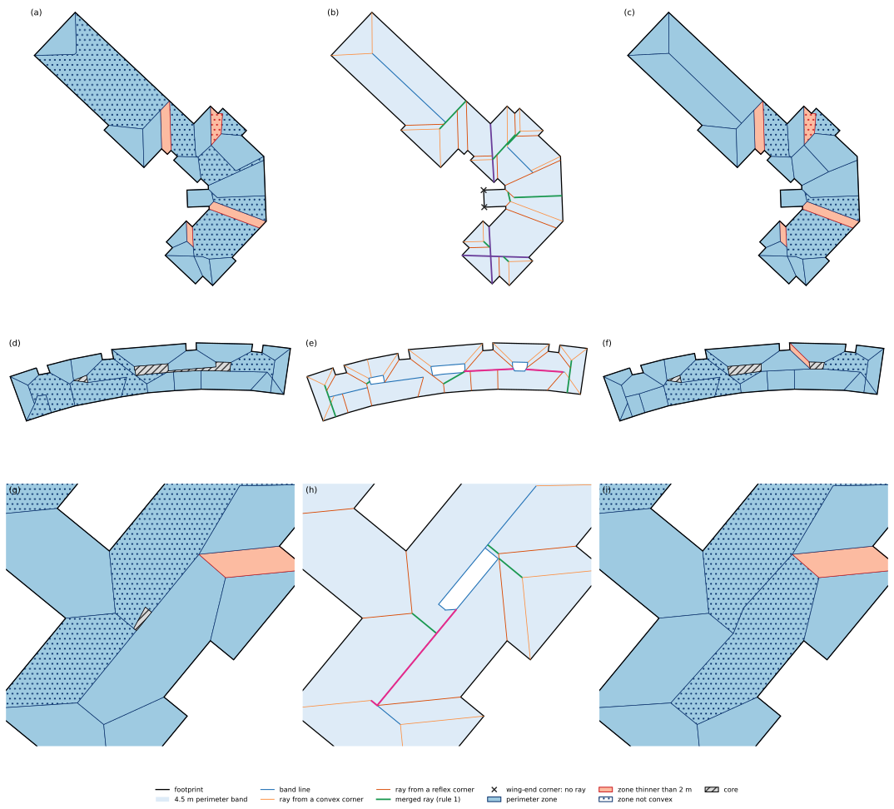

*Narrow parts: osm_0846's left wing, osm_0812's core and osm_0499's lower right wing, one per row:
the zones with narrow parts left as they are (a, d, g), the lines with the parts that became lines in pink (b, e,
h), and the zones (c, f, i).*

**Code:** `core.narrow_core_to_lines` (legs `align_legs`, notches `fill_notches`, narrow parts `narrow_tips`, lines
following the core `refit`, running on `run_on_spines`). Stage `narrow_core`. Settings: Narrow core.

### Zones

Every point lying on another line is inserted into it, and the lines and the band line cut the footprint into zones:
perimeter zones (kind `zone`, or `thin` when narrower than `min_zone_width_m`) and core parts (`core`).

**Code:** `zones.form_zones` (`node_lines`, `zones_from`).

### Rule 5: close points become one

Zone corners closer than `close_points_m` become one point at their mean. Points on the outline never move.

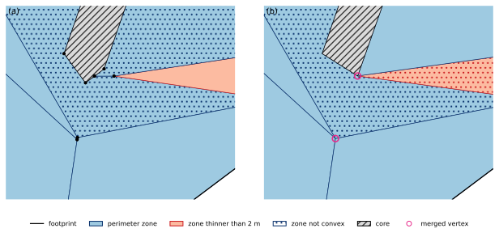

*osm_0699's bottom-left, (a) before and (b) after.*

**Code:** `zones.merge_close_points` (groups from `geometry.close_groups`). Stage `close_points`. Settings:
`close_points_m`.

### Rule 6: narrow zones give way to a diagonal

A four-cornered perimeter zone narrower than `narrow_zone_m`, with a perimeter zone across each long side, gives way
to its shorter diagonal.

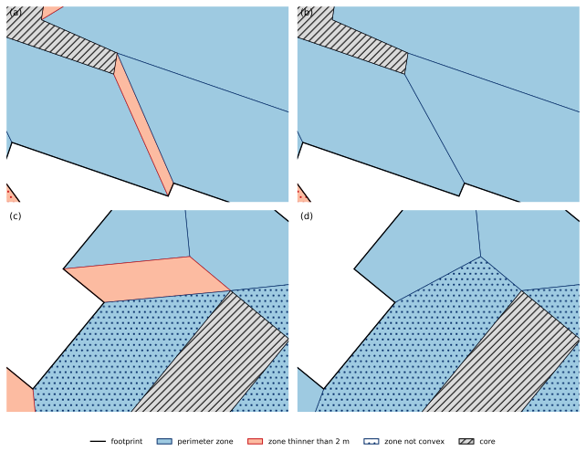

*osm_0699's lower wing (a, b) and osm_0499's left wing (c, d), before and after.*

**Code:** `zones.narrow_zones_to_diagonals`. Stage `diagonals`. Settings: `narrow_zone_m`.

### Rule 5 again: close points, longer reach

Rule 5 once more with `corner_group_m`, in groups at most `corner_group_span_m` across.

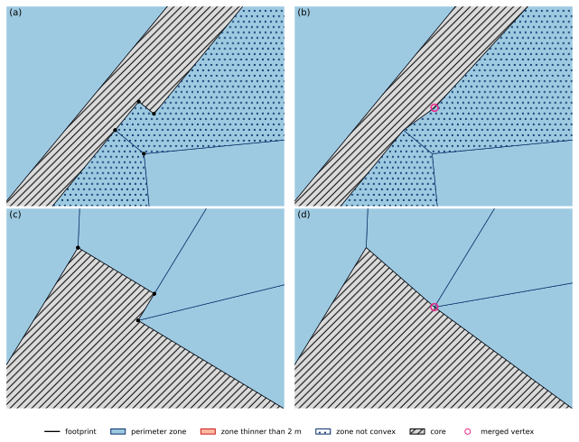

*osm_0499's upper core (a, b) and osm_0353's upper wing (c, d), before and after.*

**Code:** `zones.merge_close_points`. Stage `corner_groups`. Settings: `corner_group_m`, `corner_group_span_m`.

### Rule 7: touching thin zones merge

Zones thinner than `min_zone_width_m` that touch become one. A non-convex union takes the rest of its convex hull
from its neighbours if they stay convex and (with `hull_keeps_width`) at least `min_zone_width_m` wide. Where a
neighbour would get thinner, the hull is still taken if the rest of rules 7 and 8, run on a copy, then merge every
zone it thins; otherwise the zones merge without the hull, into a zone that is not convex.

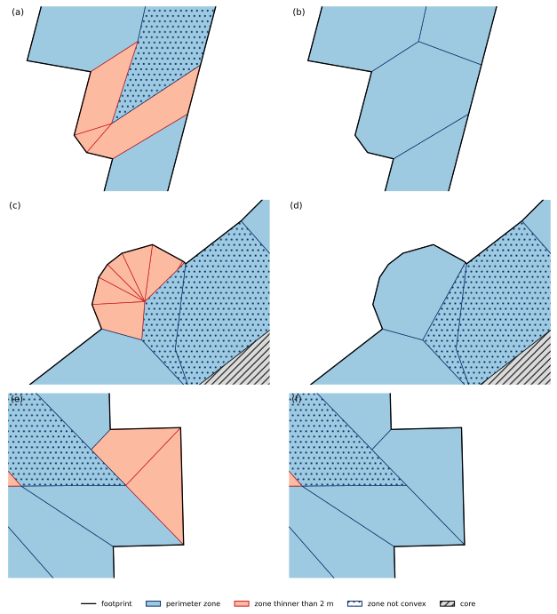

*osm_0357's wing end, osm_0192's rounded bay and osm_0307, one per row, before and
after.*

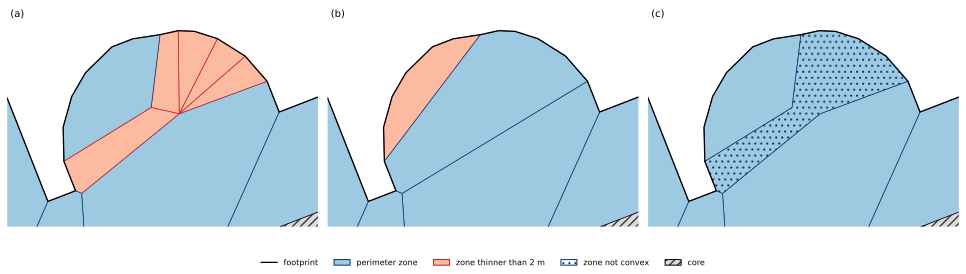

*osm_0377's rounded bay: (a) before rule 7, (b) with the hull, which would leave its neighbour 1.52 m wide,
(c) merged without it.*

**Code:** `zones.merge_touching_thin_zones`. Stage `thin_touching`. Settings: `min_zone_width_m`,
`hull_keeps_width`.

### Rule 8: lone thin zones merge

A lone thin zone merges into a neighbour when the union is convex and wide enough, after moving one end of an inner
edge to a zone corner within `relink_m` if needed.

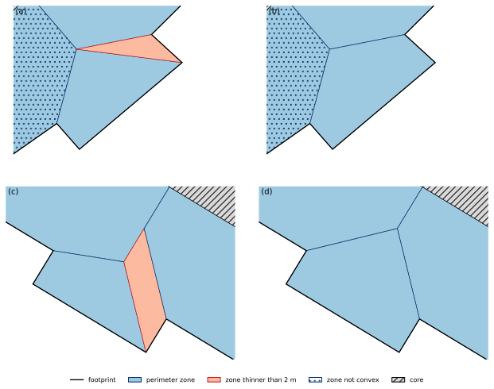

*osm_0623 (a, b) and osm_0353's lower wing (c, d), before and after.*

**Code:** `zones.merge_lone_thin_zones`. Stage `thin_lone`. Settings: `relink_m`.

### Final rounds: rule 9, rules 7 and 8, rule 10 and the tidy step

These four run as one round; with `repeat_until_stable` the round repeats until the zones no longer change, at most
eight times.

**Rule 9: sharp corners are cut off.** A zone corner sharper than `sharp_corner_deg` is cut off; the zone along most
of its shorter edge takes the tip, or the zone across the longer edge when the shorter one is on the outline. A
triangle goes whole to that zone instead when the cut would leave a new sharp corner (its rest a similar triangle,
cut again and again) or when the merged zone is convex. The cut is made on the zone's own outline: points it runs
almost straight through stay, and the cut's end lies on the zone's edge, so the zone across that edge gets the point
inserted and the zones still tile the footprint; a cut that would not keep every area exact is skipped. With
`sharp_keep_convex`, a cut that would make a convex taker non-convex is skipped. Then, with
`repeat_thin_after_sharp`, rules 7 and 8 once more for the thin zones the cuts leave.

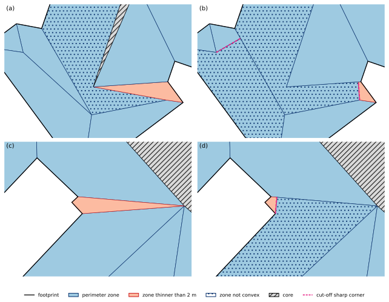

*osm_0699's bottom-left end (a, b) and osm_0719 (c, d), before and after.*

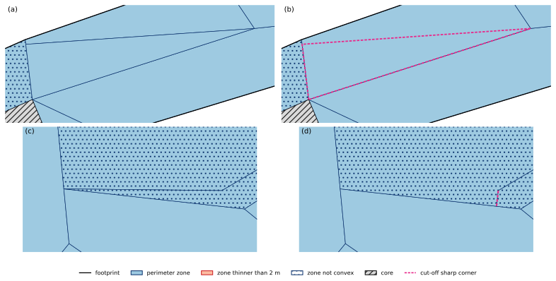

*osm_0738, where a triangle goes whole to its neighbour (its outline dashed after, b), and osm_0707,
where the shorter edge lies on the outline (c, d).*

**Rule 10: specks join a neighbour.** With `join_specks`, a perimeter zone under `speck_m2` joins the neighbour it
shares the longest edge with, convex or not.

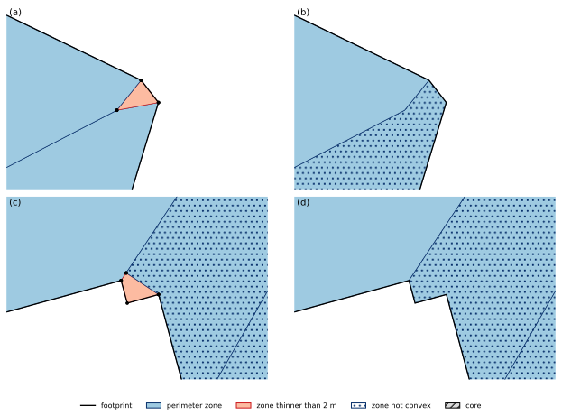

*osm_0423's chamfer (a, b) and osm_0072's step (c, d), before and after.*

**Tidy zone corners.** Inner zone corners closer than `tidy_close_m` to an outline point move onto it
(`snap_to_outline`); inner corners closer than `tidy_close_m` become one, in groups at most `corner_group_span_m`
across, at their mean or on one of them (`merge_close_again`); an inner point where a zone's corner is within
`straight_deg` of 180° moves onto the line between that corner's neighbours, with the points lying on the two edges
(`straighten_corners`, kept only if it leaves fewer zones not convex or fewer near-straight corners); inner points
straight within `collinear_deg` in every zone are dropped (`drop_collinear`). Every move applies to all zones
sharing the point and is kept only if the zones stay valid and tile the footprint, no outline point moves, no convex
zone becomes non-convex, no zone gets thinner than `min_zone_width_m` (a core part `narrow_core_m`) unless it
already was, and no corner under `sharp_corner_deg` and no speck appears. With `split_pinched`, a zone that a move
makes touch itself becomes two zones if both are convex.

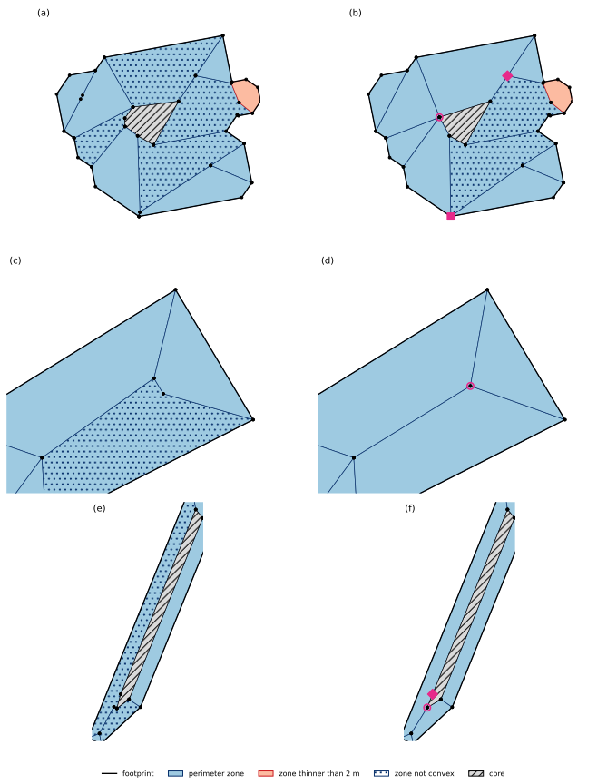

*Without and with the tidy step: a corner straightened (osm_0560), close points merged once more (osm_0270), and
a point rule 9 made merged with its neighbour (osm_0427). Squares mark points snapped to the outline, circles
points merged, diamonds points straightened.*

**Code:** `procedure._final_rounds` runs the round: `zones.cut_sharp_corners` (the taker: `zones.taker_across`),
`zones.merge_touching_thin_zones` and `zones.merge_lone_thin_zones`, `zones.join_specks`, `tidy.tidy_corners`.
Stages `sharp`, `specks` and `tidy`. Settings: Thin zones, sharp corners and specks; Tidy zone corners.

### Wing-end and bay checks

The whole procedure runs first with every wing end and bay without rays. Then, with `wing_end_check`, each wing end
whose wing (the hull of its end wall and side walls) touches a thin zone of the result is tried again with its rays;
with `bay_check`, while the result keeps a thin, non-convex or sharp zone or a speck, each bay is, and finally all
bays left together. A try is kept when the footprint's thin, non-convex and sharp zones and specks go down. A stage
`upto` is drawn with the wing ends and bays the checks kept.

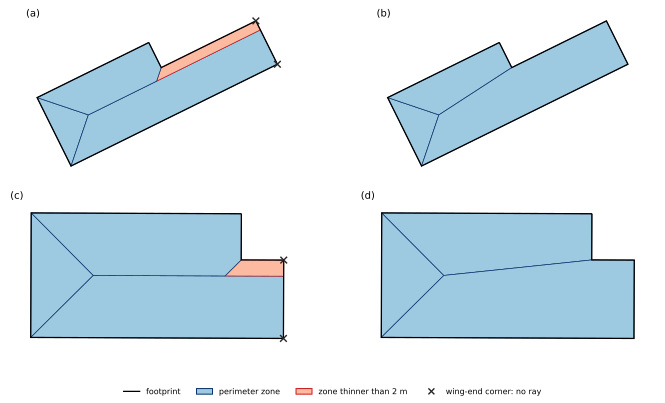

*Stepped blocks whose narrow end gets its rays back (osm_0915, osm_0395): without the check (a, c) and with
it (b, d); crosses mark the wing-end corners without rays.*

**Code:** `procedure._check_ray_sources`. Settings: `wing_end_check`, `bay_check`.

### The result

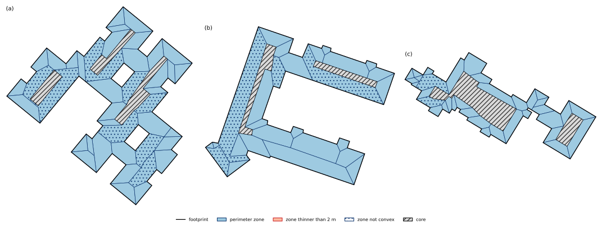

*The three test footprints with the default settings: osm_0499, osm_0699 and osm_0353.*

## Settings

Every value lives in one frozen object, `CornerRayConfig`; its defaults are the chosen settings, every step switched
on. Each field's metadata holds its section, title, help, unit, the values a run accepts (`ge`, `le`) and a slider
range that holds the default (`lo`, `hi`, `step`); `settings_table()` gives them as plain data, in the sections
below. Values outside `ge`/`le` raise `ValueError`.

**Band and rays**

| Setting | Default | Range on a page | What it does |
| --- | --- | --- | --- |
| `band_m` | 4.5 m | 2 to 8 m, step 0.1 | How deep the perimeter band along the facades is: the footprint offset inwards by this distance, with mitred corners. What lies inside the band line is the core. |
| `tie_m` (advanced) | 0.1 m | 0 to 0.5 m, step 0.01 | Rays grow from their corners at the same speed; two rays reaching a crossing within this distance of each other both stop there. |
| `min_turn_deg` (advanced) | 1 deg | 0 to 5 deg, step 0.1 | A vertex where the outline turns by less than this is not a corner and casts no ray. |

**Wing ends**

| Setting | Default | Range on a page | What it does |
| --- | --- | --- | --- |
| `wing_end_max_m` | 4 m | 0 to 6 m, step 0.1 | The two convex corners of an end wall shorter than this cast no ray (0 switches the wing ends off). Two zones side by side need twice the zone width. |
| `wing_end_parallel_deg` | 30 deg | 0 to 60 deg, step 1 | Only an end wall whose two side walls are parallel within this angle counts as a wing's end (the two corner angles add up to 180 degrees within it). On a curved facade drawn as many short walls the walls turn little at each corner, so no short wall there loses its rays; 180 lets every short wall count. |
| `wing_end_long_sides` (advanced) | off | switch | Also require both side walls to be at least as long as the end wall (a wing, not a step). |
| `wing_end_check` | on | switch | A wing end whose wing touches a zone thinner than the zone width is tried again with its rays; the result with fewer thin, non-convex and sharp zones and specks is kept. |

**Short walls**

| Setting | Default | Range on a page | What it does |
| --- | --- | --- | --- |
| `short_wall_one_ray` | on | switch | A wall shorter than the short wall length between two corners that both cast rays casts one ray: a step (one convex, one reflex corner) only its reflex corner's ray, so a line still leaves every reflex corner; a chamfer (two convex corners between longer walls) one ray from the middle of the wall. The two rays of such a wall would bound a needle or a speck. A wing's end wall and a wall between two reflex corners keep both rays. |
| `short_wall_m` | 1.5 m | 0 to 3 m, step 0.05 | A wall between two corners shorter than this casts one ray. A chamfer counts only when the walls before and after it are at least this long, so on a curve drawn as short walls no wall counts. |
| `short_wall_chamfers` | on | switch | Also a short wall between two convex corners casts one ray; off: only steps. |
| `short_wall_midpoint` (advanced) | on | switch | A chamfer casts its ray from the middle of the wall; off: from the sharper of its two corners. |
| `short_wall_to_band` | on | switch | The band line has the same step or chamfer as the outline. The one ray runs to the band line's corner that the dropped ray (a step) or the chamfer's two rays, merged, would have reached, so that corner is not left as a reflex corner of a zone. Off, or where the band line is not reached: along the reflex corner's bisector, or the mean of the chamfer's two bisectors. |
| `short_wall_tooth` (advanced) | on | switch | A convex corner between two short steps (a tooth): the reflex corner of the shorter step casts the one ray, the other continues the tooth's wall, so the two lines part instead of bounding a needle. |

**Bays**

| Setting | Default | Range on a page | What it does |
| --- | --- | --- | --- |
| `bays` | on | switch | A run of convex corners between two reflex corners (the base corners), no wider and deeper than below, where the walls on both sides run on along the line between the base corners: the corners of the run cast no ray. The bay and the triangle behind its opening become one zone. |
| `bay_width_band` | 2.5 × band | 0 to 4, step 0.1 | The distance between the two base corners, at most this many band depths. At two band depths the rays of two right-angled base corners meet on the band line. |
| `bay_depth_band` | 1.2 × band | 0 to 2, step 0.05 | How far the bay reaches out from the line between its base corners, at most this many band depths. A whole round building is far deeper than its band and keeps its rays. |
| `bay_edge_deg` | 45 deg | 0 to 90 deg, step 1 | The walls before and after the bay must each run within this angle of the line between its base corners: the bay sits on a continuous facade, not on a step or a corner (180 drops the test). |
| `bay_min_corners` | 2 corners | 1 to 6, step 1 | A bay has at least this many corners between its base corners. With 2, a rectangular bump counts too (one with parallel sides narrower than the wing-end width stays a wing end); with 3, only polygonal and rounded bays. |
| `bay_wiggle_deg` (advanced) | 5 deg | 0 to 15 deg, step 0.5 | A corner of the bay may be reflex by less than this (a wiggle where a curve was drawn as short walls); it then casts no ray either. |
| `bays_in_band` | on | switch | The core is offset from the footprint with its bays cut off at their openings, so a bay deeper than the band holds no sliver of core and the band line runs straight behind its opening. |
| `bay_check` | on | switch | While the footprint keeps a thin, non-convex or sharp zone or a speck, each bay is tried again with the rays of all its corners; the result with fewer of them is kept. |

**Rays that meet**

| Setting | Default | Range on a page | What it does |
| --- | --- | --- | --- |
| `opposite_gap_m` | 1 m | 0 to 3 m, step 0.05 | Rule 2: two rays running in opposite directions that each pass within this distance of the other's corner become one line from corner to corner. |
| `opposite_angle_deg` | 20 deg | 0 to 45 deg, step 1 | Rule 2: how far from exactly opposite the two rays' directions may be. |
| `keep_reflex_rays` | on | switch | Rule 3 discards a ray that reaches the far facade without meeting the band line or another ray. A ray from a reflex corner is kept and cast again after rule 1: a zone can only be convex if a line leaves every reflex corner. |
| `recast_discarded` (advanced) | off | switch | Rule 3 off: every ray that reaches nothing is cast again after rule 1, from convex corners too. |

**Narrow core**

| Setting | Default | Range on a page | What it does |
| --- | --- | --- | --- |
| `leg_width_m` | 2 m | 0 to 4 m, step 0.05 | A leg of the core (out along one side, across a short tip, back along a nearly parallel side) narrower than this becomes a line. |
| `leg_angle_deg` | 15 deg | 0 to 30 deg, step 0.5 | How far from parallel the two sides of a leg, or a notch's floor and its side, may be. |
| `fill_notches` | on | switch | A stretch of the core's side stepped into the core, where it leaves the core thinner than the notch passage, moves onto the line of that side, so the notch fills. |
| `notch_passage_m` | 1 m | 0 to 3 m, step 0.05 | A notch is filled where the core across its floor is thinner than this. |
| `narrow_core_m` | 1.2 m | 0 to 3 m, step 0.05 | Core thinner than this becomes a line: whole parts (with the switch below), tapered tips and passages between wider parts. |
| `collapse_narrow_parts` | on | switch | A whole core part thinner than the narrowest core everywhere becomes a line between its two ends. |
| `similar_sides_ratio` | 0.9 | 0 to 1, step 0.05 | The shorter side moves onto the longer one; when the shorter is at least this share of the longer, both move half way. |

**Close points and narrow zones**

| Setting | Default | Range on a page | What it does |
| --- | --- | --- | --- |
| `close_points_m` | 0.5 m | 0 to 1.5 m, step 0.05 | Rule 5: zone corners closer than this become one point at their mean. Points on the outline are never moved. |
| `corner_group_m` | 1.2 m | 0 to 3 m, step 0.05 | Rule 5 again, after rule 6: zone corners closer than this become one. |
| `corner_group_span_m` | 2 m | 0 to 5 m, step 0.1 | Rule 5 again: a group of corners merged into one may be at most this wide. |
| `narrow_zone_m` | 2 m | 0 to 4 m, step 0.05 | Rule 6: a four-cornered perimeter zone narrower than this, with a perimeter zone across each long side, gives way to its shorter diagonal. |

**Thin zones, sharp corners and specks**

| Setting | Default | Range on a page | What it does |
| --- | --- | --- | --- |
| `min_zone_width_m` | 2 m | 0 to 4 m, step 0.05 | A perimeter zone narrower than this is thin: rules 7 and 8 merge thin zones, and a merge must leave a zone at least this wide. |
| `relink_m` | 4 m | 0 to 8 m, step 0.25 | Rule 8: an inner edge of a lone thin zone may move one end to a zone corner this close, so the zone can merge into a neighbour. |
| `sharp_corner_deg` | 20 deg | 0 to 45 deg, step 1 | Rule 9: a zone corner sharper than this is cut off; the zone across its shorter edge takes the tip. |
| `sharp_keep_convex` (advanced) | off | switch | Rule 9: skip a cut that would make the convex zone taking the tip non-convex. |
| `repeat_thin_after_sharp` (advanced) | on | switch | Rules 7 and 8 run once more after rule 9, for thin zones its cuts leave. |
| `hull_keeps_width` | on | switch | Rule 7: a zone giving area to the convex hull of merged thin zones must stay at least the zone width wide (a core part the narrowest core), unless rules 7 and 8 then merge it. Where it would stay thinner, the thin zones merge without the hull, into a zone that is not convex. |
| `join_specks` | on | switch | Rule 10: a perimeter zone smaller than the speck area joins the neighbour it shares the longest edge with, even if the union is not convex; a zone without area is dropped. |
| `speck_m2` | 0.5 m² | 0 to 2 m², step 0.05 | Rule 10: a perimeter zone smaller than this is a speck. |
| `repeat_until_stable` (advanced) | on | switch | Rules 9, 7, 8 and 10 and the tidy step run again, in turn, until the zones no longer change (at most 8 rounds). |

**Tidy zone corners**

| Setting | Default | Range on a page | What it does |
| --- | --- | --- | --- |
| `snap_to_outline` | on | switch | An inner zone corner closer than the tidy reach to an outline point (a footprint corner or a line end on the facade) moves onto it. The outline point itself never moves. |
| `merge_close_again` | on | switch | Rule 5 once more, on the zones the later rules left: inner zone corners closer than the tidy reach become one (at their mean, or on one of them), in groups at most the widest group across. |
| `tidy_close_m` | 1.5 m | 0 to 3 m, step 0.05 | How close an inner zone corner must be to an outline point to snap onto it, or to another inner corner to become one with it. |
| `split_pinched` | on | switch | Where a tidy move brings two corners of one zone together, the zone falls apart into its two parts, each a zone of its own, if both are convex; otherwise the move is skipped. |
| `straighten_corners` | on | switch | An inner point where a zone's corner is within the tolerance of 180 degrees moves onto the straight line between that corner's two neighbours, in every zone that has it. |
| `straight_deg` | 2 deg | 0 to 5 deg, step 0.1 | A zone corner this close to 180 degrees counts as nearly straight. |
| `drop_collinear` | on | switch | An inner point that is straight in every zone that has it is dropped: no zone has a corner there. |
| `collinear_deg` (advanced) | 0.1 deg | 0 to 1 deg, step 0.01 | A point this close to straight counts as collinear. |

## What a result holds

`PerimeterResult` keeps the footprint (`poly`), the settings (`config`), `upto`, the `zones` (`(polygon, kind)` pairs
that tile the footprint: a gap or an overlap larger than a millionth of the footprint's area raises `PerimeterError`)
and what each step made, in the order the steps run:

- which corners cast rays: `corners` (the corners that cast rays, as `(point, direction, interior angle, ring)`),
  `wing_ends` and `bay_corners` (those that did not), `wing_ends_restored` and `bays_restored` (given their rays
  back by the checks), `short_walls` (one dict per short wall: kind, wall, length, the corners without a ray of their
  own, the point that casts the ray);
- the band, the rays and rules 1 to 3: `offset_core` and `offset_band_line` (the core and band line as offset),
  `lines` (the rays, merged rays and corner-to-corner lines, each a `Line` with its `kind` `ray`, `merged_ray` or
  `corner_line`, what it `stop`s on, whether it comes from a `reflex` corner and whether it was cast `again`),
  `opposite_pairs` (rule 2), `discarded` (rule 3);
- rule 4: `legs`, `notches`, `narrow_parts`, then `core` and `band_line` (the core after rule 4, and its outline
  with the lines the narrow core became);
- rules 5 to 10 and the tidy step: `points_merged`, `diagonals`, `corner_groups`, `thin_merged`, `lone_merged`
  (with whether a relink came first), `sharp_cuts`, `sharp_whole` (triangles rule 9 handed over whole),
  `specks_joined`, `tidied` (the tidy step's `snapped`, `merged_again`, `straightened` and `collinear_dropped`
  points) and `rounds` (of the final rounds).

`band`, `perimeter_zones` and `core_parts` are derived from them; `counts()` gives the numbers.

## Previews for a settings page

`preview(poly, config)` runs the procedure for one building and never raises:

- `layers`: shapely geometries in the footprint's frame, `before` the perimeter (`footprint`) and `after` it
  (`perimeter_zones`, `thin_zones`, `core`, `not_convex` as outlines, `band_line`, `rays`, `merged_rays`,
  `corner_lines`, `wing_ends`, `bay_corners`), in drawing order; `LAYER_TITLES` names them.
- `numbers`: `NUMBERS` in order, `(key, label, unit)`: corners, wing-end and bay corners, short walls, perimeter
  zones, core parts and the core's share of the floor area, thin and non-convex zones, corners under 20°, specks,
  the narrowest zone, and how often each step acted.
- `fate`: `{"status": "kept"}`, or `{"status": "dropped", "reason": "perimeter_failed", "detail": {"error": ...}}`
  for a footprint the procedure cannot zone (none of the 990 test footprints).
- `seconds` and `result` (the `PerimeterResult`, or `None` when dropped).

`zone_records(result)` gives the zones as rows (`zone`, `kind`, `area_m2`, `min_width_m`, `convex`, `geometry`).

## How it was checked

On the 990 footprints of ConvexDecomp's BEM4AI sample (one process, about 60 s for all on a shared machine, median
0.02 s and at most 3 s per footprint, none failed; the wing-end and bay checks run the procedure again for some
footprints), with the default settings, and with rays from every corner (`wing_end_max_m = 0`):

| | Rays from every corner | Defaults |
| --- | --- | --- |
| Perimeter zones | 7,334 | 7,250 |
| Zones thinner than 2 m (footprints with any) | 175 (94) | 92 (73) |
| Zones not convex (footprints with any) | 368 (246) | 361 (240) |
| Corners under 20° | 0 | 0 |
| Specks under 0.5 m² | 0 | 0 |
| Footprints with none of these | 701 | 722 |
| Footprints without a core | 363 | 363 |

The thin zones that stay are small: median 5.2 m² and 1.53 m wide, together 0.2 % of the perimeter zones' area.
Rule 4 leaves no core thinner than 1.2 m, but rule 5 again can still thin a small core part afterwards (osm_0472 and
osm_0568, about 1 m² each).

`tests/test_corner_perimeter.py` checks nine real footprints (`tests/data/corner_perimeter_footprints.json`: their
counts with the defaults and with the short walls, bays and tidy step switched off, the tiling, that no outline
point moves, and what rules 7, 9 and 10 and the wing-end check change on them), the wing ends on a narrow leg and on
a round building, bays on a block with a five-sided bay and a rectangular bump and on real footprints, simple
shapes, a triangle rule 9 hands over whole, a neighbour found within rounding, a speck joining its neighbour, every
stage, determinism, the settings table and the preview; `tests/test_corner_perimeter_tidy.py` the tidy step
(straightening, collinear points, snapping to the outline, the test footprints).

## Tools

`tools/corner_perimeter/` draws and runs the method on the sample (`temp/perimeter/subset_snapshot.pkl` by default):

| Tool | What it does |
| --- | --- |
| `pipeline_diagram.py` | the pipeline diagram above (`figures/perimeter_pipeline.svg`) |
| `note_figures.py` | the step figures (`--out src/convexdecomp/corner_perimeter/figures`) |
| `run_sample.py` | the procedure on all footprints, with counts per footprint |
| `compare_variants.py` | the sample with each switch off in turn, against the defaults |
| `overview.py` | each footprint's lines and zones side by side, with how often each step acted |
